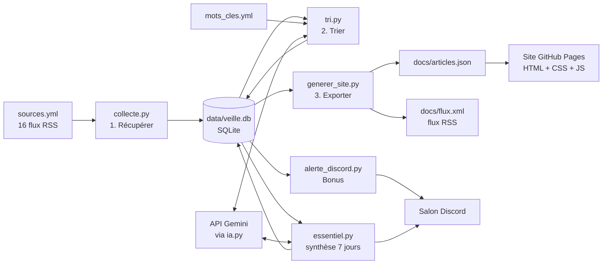

# Veille IA

Outil de **veille technologique automatisée** sur l'intelligence artificielle,
du point de vue d'un développeur. Réalisé dans le cadre du **BTS SIO option SLAM**.

🔎 **Site de la veille :** https://mohamed-ali-akir.github.io/veille-ia/

Chaque jour, le programme récupère les articles de 16 sources (flux RSS), garde ceux
qui parlent d'IA, les fait résumer et noter par une IA (Google Gemini), les stocke
dans une base SQLite et les publie sur un site avec **recherche instantanée**.
Les articles les plus importants sont aussi envoyés sur **Discord**, et chaque semaine
l'IA écrit **« L'essentiel de la semaine »** en 5 points sourcés.

📡 **Suivre la veille dans un lecteur RSS :** https://mohamed-ali-akir.github.io/veille-ia/flux.xml

## Architecture



Toute la chaîne est lancée **deux fois par jour** par **GitHub Actions**
(`.github/workflows/veille.yml`), sans que mon ordinateur soit allumé.

| Étape | Fichier | Rôle |
|---|---|---|
| 1. Récupérer | `collecte.py` | Lit les flux RSS, ignore les doublons et les articles de plus de 30 jours |
| 2. Trier | `tri.py` | Filtre par mots-clés, puis l'IA écrit un résumé en français, choisit des tags, donne une note de 0 à 5 et **justifie sa note** |
| 3. Stocker | `base.py` → `data/veille.db` | Base SQLite partagée par tous les scripts (avec migration automatique) |
| 4. Retrouver | `generer_site.py` → `docs/` | Exporte les articles en JSON et en **flux RSS** ; le site les affiche avec recherche et filtres |
| Synthèse | `essentiel.py` | Tous les 7 jours, « L'essentiel de la semaine » en 5 points, chacun relié à son article |
| Bonus | `alerte_discord.py` | Envoie les articles notés 4 ou 5 (et la synthèse) sur Discord, un message par article |
| Favoris | `favoris.py` | Un bot Discord lit mes réactions ⭐ : l'article passe dans l'onglet « Favoris » du site et le salon #favoris |
| Qualité | `tests.py` | 41 tests automatiques, lancés à chaque push et avant chaque veille |

## Structure du projet

```
veille-ia/
├── sources.yml            liste des flux RSS (modifiable sans toucher au code)
├── mots_cles.yml          mots-clés du filtre
├── base.py                ouverture de la base SQLite (structure des tables, migration)
├── ia.py                  appel à l'IA (Gemini ou Mistral), partagé par tri et essentiel
├── reseau.py              erreurs réseau et nouvel essai automatique en cas de panne passagère
├── collecte.py            étape 1 : récupérer
├── tri.py                 étape 2 : trier (mots-clés + IA)
├── generer_site.py        étape 3 : exporter pour le site
├── essentiel.py           « L'essentiel de la semaine » (synthèse IA tous les 7 jours)
├── alerte_discord.py      bonus : alertes Discord
├── favoris.py             favoris : réactions ⭐ sur Discord → base → site
├── chercher.py            recherche en ligne de commande (secours)
├── synthese.py            brouillon de synthèse mensuelle → syntheses/
├── tests.py               tests automatiques
├── data/veille.db         la base de données (branche data)
├── docs/                  le site web (publié par GitHub Pages)
│   ├── index.html         page de recherche
│   ├── methodologie.html  explication de la démarche
│   ├── style.css          apparence (mode sombre, version mobile)
│   ├── app.js             recherche instantanée et filtres
│   ├── articles.json      données (fichier généré, branche data)
│   └── flux.xml           flux RSS des articles 4-5★ (fichier généré, branche data)
└── .github/
    ├── sauvegarder-donnees.sh   enregistre la base et les fichiers générés sur la branche data
    └── workflows/
        ├── veille.yml     la veille complète, 2 fois par jour
        ├── favoris.yml    synchronisation des favoris ⭐, toutes les 5 minutes
        ├── site.yml       publication du site (code de main + données de data)
        └── tests.yml      tests à chaque push et pull request
```

### Deux branches : le code et les données

- **`main`** contient le code. Son historique ne montre que les vrais changements.
- **`data`** contient seulement ce que la veille produit : `data/veille.db`, `docs/articles.json` et `docs/flux.xml`.
  Elle garde un seul commit, remplacé à chaque sauvegarde : la base contient déjà tout l'historique des articles,
  inutile d'en garder deux copies par jour (le dépôt grossirait sans fin).

Le site publié assemble les deux : le HTML, le CSS et le JavaScript de `main`, les données de `data`.

## Utilisation sur mon PC (Windows)

```bash
py -m pip install -r requirements.txt   # installer les bibliothèques (une seule fois)
git fetch origin data                   # récupérer les dernières données de la veille...
git restore --source=origin/data --worktree -- data/veille.db docs/articles.json docs/flux.xml   # ...et les copier ici
py collecte.py                          # récupérer les nouveaux articles
py tri.py                               # filtrer + analyser par l'IA
py essentiel.py --forcer                # écrire l'essentiel de la semaine tout de suite
py generer_site.py                      # mettre à jour docs/articles.json et docs/flux.xml
py alerte_discord.py                    # envoyer les alertes Discord
py favoris.py                           # synchroniser les favoris (réactions ⭐)
py -m unittest -v tests                 # lancer les tests
py chercher.py agent                    # chercher un article en ligne de commande
py synthese.py                          # brouillon de la synthèse du mois (syntheses/)
py -m http.server --directory docs      # voir le site sur http://localhost:8000
```

Sous Linux (GitHub Actions), on remplace `py` par `python`.

> ⚠️ GitHub Actions modifie la base deux fois par jour. Avant de travailler sur mon PC, je récupère
> les dernières données (les deux commandes `git` ci-dessus). Les fichiers de données sont ignorés par git sur
> `main` : une base modifiée sur mon PC n'est jamais envoyée par erreur.

## Fiabilité

La veille tourne seule, sans personne pour la surveiller. Elle est donc conçue pour encaisser les pannes :

- **Pannes réseau** : toutes les erreurs possibles (site injoignable, délai dépassé, connexion coupée, réponse tronquée) sont regroupées dans `reseau.py`. Une panne passagère de l'API d'IA (erreur 5xx, connexion coupée) est réessayée 3 fois, avec une pause qui double à chaque essai. Une source ou un message Discord en échec n'arrête jamais le reste.
- **Rien n'est perdu** : la base enregistre chaque article dès qu'il est traité, et le workflow sauvegarde ce qui a été fait même si une étape plante. Un article envoyé sur Discord est donc toujours marqué comme envoyé : il ne sera jamais renvoyé en double.
- **Pas de conflit** : la veille et les favoris partagent le même groupe de concurrence, ils ne modifient jamais la base en même temps. Les données vont sur la branche `data`, où personne d'autre n'écrit : un commit poussé sur `main` pendant la veille ne la gêne plus.
- **Versions figées** des bibliothèques (`requirements.txt`), mises à jour par Dependabot après passage des tests.

## Secrets (jamais dans le code)

Le dépôt est public : les clés sont dans des **variables d'environnement**.

| Nom | Où le mettre | Rôle |
|---|---|---|
| `GEMINI_API_KEY` | PC : `setx GEMINI_API_KEY "..."` · GitHub : Settings > Secrets and variables > Actions | clé de l'API Gemini |
| `MISTRAL_API_KEY` | idem (facultatif) | IA de secours si pas de clé Gemini |
| `DISCORD_WEBHOOK_URL` | idem | adresse du salon Discord des alertes |
| `DISCORD_BOT_TOKEN` | idem | jeton du bot qui lit les réactions ⭐ (droits : voir le salon, lire l'historique) |
| `DISCORD_WEBHOOK_FAVORIS` | idem | adresse du salon #favoris |

## Ajouter une source

Ouvre `sources.yml` et ajoute un bloc :

```yaml
  - nom: Nom du site
    url: https://adresse-du-flux-rss
    categorie: Actualité FR
```
